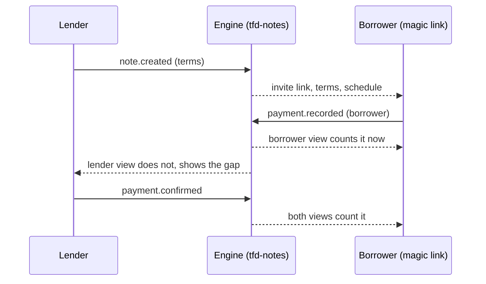

# Promissory notes: a shared record of a loan, its schedule, payments and receipts

> Trifold should let a lender and a borrower keep one append-only record of a loan: the terms, the schedule they agreed,
> every payment, and each side's acknowledgment of it. The engine computes every balance; a person records and confirms
> every fact; a number anyone can recompute with an Apache-2.0 library.

## Problem

Family, co-op, church and school loans live in texts, a spreadsheet and memory. When the lender says $6,550 is left and
the borrower says $6,200, nobody can show where the $350 went: a payment that was never confirmed, a past payment never
written down, interest worked out two ways. A note record that only one side keeps proves nothing to the other. The
record has to be shared, show each side's own count, and say what is confirmed and what is only claimed.

## Goals / Non-goals

Goals:
- One append-only event stream per note: terms, schedule, payments, confirmations, disputes, annotations.
- Engine-computed balances, accrued interest, expected-vs-paid and days overdue; every figure replays from the events.
- Show the lender's balance, the borrower's balance and the itemised difference. Never decide the truth for them.
- Past payments can be backfilled and are labelled as claims until the other side confirms them.
- The calculator is Apache-2.0 and runs in browsers, Workers and Bun, so anyone can recompute a statement.
- A counterparty needs no account: a magic-link guest view (decided 2026-11-12).

Non-goals (this spec; later milestones in the build order):
- Public pages, pseudonyms, per-event audiences, grant levels (the reviews cut them from v1).
- Late fees, default rates, collateral, guarantors, assignment, structured forbearance, foreign currency.
- Rifo drafting. Rifo is not shipped; the engine and the people work without it.
- Legal advice or any claim that a record is enforceable (see Claim limits).

## Users & scenarios

- **Maria, a lender**, lent Ana $10,000 at 5%. She records the note, records the payments Ana hands her, and confirms or
  disputes the ones Ana records.
- **Ana, a borrower**, opens a magic link on her phone, sees the terms and her balance, records a $350 payment with a
  photo of the transfer, and sees Maria's count beside her own until Maria confirms.
- **A co-op treasurer** tracks a dozen member loans (organizations as parties come after the engine).
- **An accountant** is shown a read-only statement by one party (sharing presets come after the engine).

## Workflow

## Spec table

| ID | Rule | Limit | Inputs → outputs |
|---|---|---|---|
| R-1 | A note is a stream of `tfd.note-event.v1` events with a per-note `seq` starting at 1 with no gaps; everything else is derived by replay | Hash chain and signatures are build step 3, not here | events → statement |
| R-2 | Money is an integer count of minor units carried as a digit string; the currency code and its decimal exponent are in the terms; no floats anywhere | Exponent 0 to 4 | terms → amounts |
| R-3 | A rate is a decimal string of at most 6 places and under 1, i.e. under 100% a year (`"0.0525"`, `"0"` allowed), parsed exactly; interest is exact rational arithmetic on `bigint` | No `Number` in any money or rate path | rate → rational |
| R-4 | Interest is simple, daily, actual days over 365, on principal outstanding; interest never accrues on interest | One day count in v1 | balance, dates → interest |
| R-5 | Interest accrues exactly. At each installment date and at each report the interest due is the exact accrued amount rounded half up (never below zero); a payment covers it first, and the exact remainder, positive or negative, carries forward. A schedule is what the statement replay shows if every row's payment is made on its due date | The rounding point is part of the contract | interest → minor units |
| R-6 | Dates are civil `YYYY-MM-DD`; the engine does no time-zone work; the caller turns a recorded instant into a date with the note's IANA zone. The one place the engine reads an instant is the age of an unanswered event, which uses the UTC date of `entered_at` | Zone lives in the terms; the age can differ by a day from the note's local date | instant, zone → date |
| R-7 | Schedule types: `amortized` (weekly, biweekly or monthly, `count` installments from `first_due`), `custom` (an explicit list of due dates and amounts, so balloon and interest-only fit) and `none` (informal) | Monthly dates anchor on the first due day and clamp to month end | terms → schedule |
| R-8 | The amortized level payment is the smallest whole minor-unit payment for which installments 1 to `count − 1`, simulated with the R-5 carry, leave a final installment no larger than the level payment; the final installment absorbs the rounding; row payments are capped at what is owed and unpaid interest is never added to principal | Found by exact integer search; `count` at most 5200 | terms → payment, rows |
| R-9 | A payment applies to the accrued unpaid interest first, then to principal; any amount beyond the payoff is reported as `overpaid`, not applied | No fee bucket in v1 | payment → split |
| R-9a | A reversal (a bounced check) undoes one whole payment: it must equal that payment's amount, be dated on or after it, and makes the statement read as if the payment never happened, so the interest it covered accrues again; a payment is reversed at most once; a reversal counts in a view when that view counts any positive amount for it, and then undoes the whole payment; a counted reversal gets its own difference row showing minus the payment amount, and the payment keeps its row, so the rows net to the payoff gap | Partial reversals are a later milestone | reversal → view |
| R-10 | A fact that hurts the party who recorded it counts in both views at once; a fact that helps the recorder counts in the recorder's view only until the other party confirms it | A borrower payment and a lender reversal help their recorder; a lender payment and a borrower reversal hurt theirs | event → view membership |
| R-11 | A dispute names a counter-amount and a reason, and moves only the disputing party's view to the counter-amount; a bare "disputed" is refused. A resolution takes effect only when both parties have entered `payment.resolved` for that payment with the same agreed amount since the last dispute; until then the dispute stands. A party may later confirm a payment it disputed (withdrawing the dispute); a `payment.resolved` filed when no dispute stands is ignored, and a party's latest filing since the last dispute is the one that counts | The recorder's view keeps the original amount until a resolution | dispute → view |
| R-12 | There is no deemed confirmation and no "confirm the balance" action: a confirmation covers one event; an unanswered event shows as unanswered with its age | No timer changes any number | event → status |
| R-13 | `payment.recorded` carries two dates, the `value_date` (when it is said to have happened) and `entered_at` (when it was entered), plus who entered it | `entered_at` is the caller's clock until the witness exists | event → provenance |
| R-14 | A backfilled payment has `source: lender-states` or `borrower-states`, carried on the event and on its difference item; "both agree" is derived from the counterparty's confirmation and is never typed or stored | Surfaced as a label once confirmations are signed (build step 3) | event → label |
| R-15 | The statement for an `as_of` date returns the schedule, the lender view, the borrower view, the itemised difference, expected-vs-paid, days overdue and the engine version | Pure function: no clock, no store | events, date → statement |
| R-16 | Expected cumulative is the sum of installments due on or before `as_of`; overdue is `expected − paid` when positive and never more than the view's payoff, counted in days from the earliest due date whose cumulative expected exceeds paid; a paid-off note is never overdue | `none` schedules are never overdue | schedule, payments → overdue |
| R-17 | The library is Apache-2.0, zero dependencies, with no `node:` import, `Buffer`, `eval` or `new Function`, so it runs in Bun, Node, Workers and browsers | Enforced by a test | n/a |
| R-18 | Test vectors under `tests/golden/` are CC0-1.0 and are the cross-language contract | A second implementation must reproduce each expected file's values exactly (compared as parsed JSON) | vectors → engine |
| R-19 | An unlabelled claim never reads as proof: statements say "confirmed", "claimed by lender", "claimed by borrower", "disputed" | Wording follows `AGENTS.md` claim rules | statement → text |

## Event set

Build step 1 implements the first six; the rest are schema-reserved and listed so the stream is forward compatible.

- `note.created`: terms, parties' roles, signed-document hash (optional)
- `payment.recorded`: amount, `value_date`, method, reference, `kind` (`payment` or `reversal`), `reverses`, `source`
- `payment.confirmed`: references one event
- `payment.disputed`: references one event, `counter_amount_minor`, `reason`
- `payment.resolved`: references the disputed event, `agreed_amount_minor`
- `annotation.added`: text and an optional attachment hash; no number changes
- Reserved, step 2 onward: `schedule.proposed`, `schedule.accepted`, `notice.sent`, `waiver.granted`, `release.drafted`,
  `release.confirmed`, `visibility.changed`, `party.rebound`

## Acceptance criteria

- **AC-1** The amortized schedule for $10,000, 5%, 36 monthly installments from the first due date is identical across
  runs, ends at a zero balance, and its rows sum to the principal plus the interest.
- **AC-2** Rate `"0"` gives a level payment of ceil(principal / count) and no interest rows.
- **AC-3** A statement is identical for any order of events with the same `seq`, and rejects a stream with a gap or a
  repeat in `seq`.
- **AC-4** A borrower-recorded payment moves only the borrower view; a lender confirmation moves the lender view; the
  difference list shows the payment until then and not after.
- **AC-5** A lender-recorded payment moves both views at once; a borrower dispute with a counter-amount moves only the
  borrower view.
- **AC-6** A dispute without a counter-amount or a reason is rejected by the validator.
- **AC-7** A payment dated before an earlier one replays to the same totals as the same events in date order.
- **AC-8** An overpayment is reported as `overpaid` and the balance does not go negative.
- **AC-9** For a `custom` schedule with a balloon, expected-vs-paid and days overdue match hand-computed vectors.
- **AC-10** Every golden vector reproduces from `bun test`; a vector whose expected value changes fails.
- **AC-11** `tfd-notes` imports no `node:` module, runs under `bun test` and typechecks with `tsc --noEmit`.
- **AC-12** `tfd note schedule` and `tfd note statement` print the same figures as the library.

## Edge cases

| Case | What happens |
|---|---|
| Lender never confirms a borrower payment | Borrower view counts it, lender view does not, the difference lists it as unanswered with its age; no timer changes it |
| Borrower disputes every lender payment | Each dispute needs a counter-amount and a reason; the difference lists each one |
| Payment recorded for a date before issue | Rejected |
| Payment larger than the payoff | Applied up to the payoff; the rest is `overpaid` |
| Reversal (bounced check) after a confirmation | A `reversal` payment event for the whole payment; a lender-entered reversal helps the lender, so it counts for the lender at once and for the borrower on confirmation; a borrower-entered one counts for both. A second reversal of the same payment, a partial amount or an earlier date is rejected |
| Both parties file `payment.resolved` with different amounts | The dispute stands; no resolution takes effect |
| A party confirms a payment it already disputed | The latest of confirm, dispute and resolution decides, so the dispute is withdrawn |
| Principal of 0, `first_due` on or before `issue_date`, or more than 5200 installments | Rejected by the validator |
| Backdated backfill changes later interest splits | The statement is a pure replay, so later splits move; frozen splits and signed adjustment events are build step 3 |
| Monthly schedule from the 31st | Anchors on 31, clamps to month end, returns to 31 |
| Rate of 0 with `none` schedule | Principal only; never overdue |
| Leap year | Actual days over 365, so a leap-year February accrues 29 days at the daily rate |

## Risks

| Risk | Mitigation |
|---|---|
| The record reads as legal proof | Claim limits below; wording rule R-19; a lawyer reviews before any launch claim |
| "Confirm" read as acknowledging the whole debt (limitations periods can restart) | Confirmation is per event; there is no balance confirmation (R-12) |
| Names and attachments stored in hashed bytes break erasure | Step 3 keeps personal data out of signed bytes and commits to it with salted hashes |
| Backdated events can't be told from insertions without a hash chain | Step 3 adds a per-note chain ordered by recording time |
| Becoming a consumer reporting agency | No lookup by person, no profile across notes, no bureau data (build order, step 5) |
| Usury, tax and licensing rules differ by place | Warn on rate above a configured cap; say "not legal or tax advice" |

## Claim limits

Never say "legally binding", "enforceable", "court-ready", "proof of payment", "builds credit", "tamper-proof",
"private" without listing who can still see the record, or "delete" for narrowing an audience. Say "confirmed by both
parties", "recorded", "claimed". No named school, family or co-op uses it until one does.

## Use: Pay later on B4 Uni

Decided 2026-11-22 by the owner; the tfd side is built (`packages/atm/src/billing/pay-later.ts`, README "Pay later"), and not live. "Pay later" on B4 Uni's pricing pages is a promissory note built on
tfd-notes: B4 Uni or a school is the lender, a parent is the borrower, and the rate is zero (`annual_rate` `"0"`,
`amortized` schedule). Each installment is paid through a tfd one-time checkout tied to the note, and the payment is then
recorded as an event on the note.

- **Recording.** The lender side records the paid checkout as `payment.recorded` (`kind: payment`, `method: checkout`,
  `reference` the checkout or payment id). A payment the lender records hurts the lender, so it counts in both views at
  once (R-10) and the parent can still dispute it (R-11). A failed, refunded or charged-back checkout is a whole
  `reversal` of that payment (R-9a).
- **Parent view.** A magic-link guest view (build step 2, not built) shows the schedule, the payments and the balance.
  Until it ships, the engine produces statements and the CLI prints them.
- **Evidence.** Matching a checkout to Stripe's records is build step 6. Until then `reference` is only a string the
  lender entered; the statement does not claim Stripe moved the money.
- **Limit for counsel.** In our reading, which is not legal advice, US Truth in Lending (Regulation Z) can cover
  consumer credit payable in more than four installments even at zero interest. So the pricing side caps Pay later at
  **4 installments** until counsel says otherwise. The engine does not enforce that cap (it accepts up to 5200
  installments); the cap lives in the pricing configuration. Counsel should also say whether B4 Uni or a school as lender
  needs a license, disclosures or state-law handling, and what a parent must be shown before they agree.
- **Wording.** Pricing pages say "Pay later" and "installments". They never say "interest-free credit", "legally
  binding" or "enforceable" (Claim limits above).

## Build order

1. **Engine (this milestone):** `packages/tfd-notes` (Apache-2.0): money, rates, dates, schedule, accrual, event schema,
   validator, statement with two views; golden vectors; `tfd note schedule|statement` in the CLI.
2. Counterparty invite by magic link: confirm, dispute, record; email code for sensitive actions.
3. Hash chain, party confirmations as signatures, signed receipts, payoff statement, release, verify links.
4. Organizations as parties with agents and two-person approval; portfolio view.
5. Sharing presets: Private, Shared with a named person, Verify link.
6. Later: Stripe evidence, fees and default, Rifo drafting, the witness.

## Open questions

1. **Payer-decides ceiling.** The reviews say audience should be per note and widening should need every named party;
   the owner leans Venmo-style (payer decides). Resolve before step 5.
2. Whether organizations as parties move ahead of step 4 for the first co-op or church customer.
3. Whether a magic-link guest confirmation may be called a signature (it should not; it is "confirmed by the holder of
   this email address") before per-party keys exist.
4. Usury caps and below-AFR family loan warnings: which places, and who maintains the table.
5. Counsel on Pay later: Regulation Z coverage above four installments (and at four or fewer), lender licensing and
   disclosures for B4 Uni or a school, and state consumer-credit rules. Until answered, Pay later stays at 4 installments.

## Out of scope

Public visibility, organizations, guests' account upgrade, receipts and seals over note events, payment processing,
credit reporting, drafting by Rifo.
